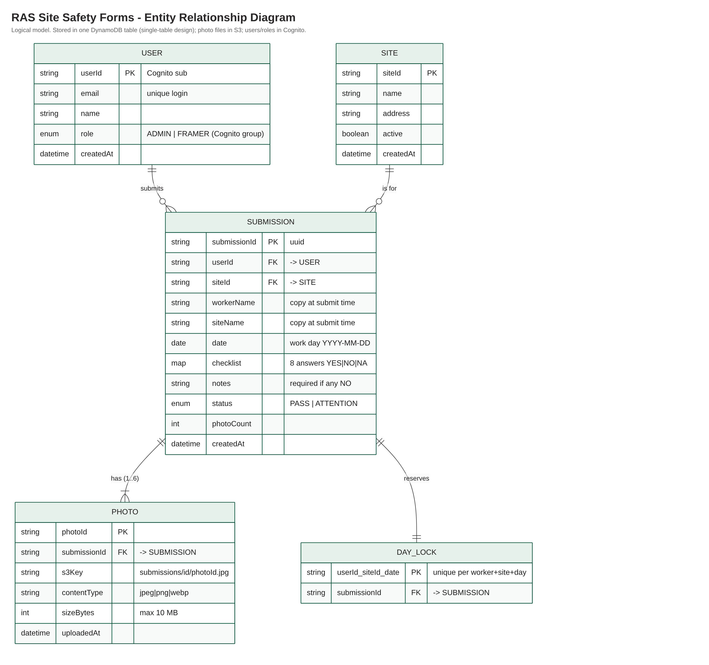

<div align="center">


# RAS Site Safety Forms — AWS Serverless Lambda Microservices + React

**Daily site-safety forms for framing crews — AWS Lambda microservice + React MVVM frontend**


Framers fill in a daily safety form (checklist + photos) on their phone. Supervisors see who submitted on each site, when, and review the photos.

</div>

> Built for the RAS (Ron Anderson & Sons) Junior Software Developer technical assessment. Not used by RAS. All people, sites and photos in the demo data are fictional.

| | |
|---|---|
| **Live app** | https://YOUR-DISTRIBUTION.cloudfront.net |
| **ERD** | [docs/ERD.md](docs/ERD.md) · [docs/erd.png](docs/erd.png) |
| **Admin login** | `admin@example.com` / `RasAdmin2026` |
| **Framer login** | `framer@example.com` / `RasFramer2026` (has **not** submitted today, so you can try the form) |

---

## Features

- 📋 **Safety form (Framer)** — job site + date, worker name from login, 8-item checklist (PPE, fall protection, ladders/scaffolding, tools & cords, hazards) with big **Yes / No / N/A** buttons, notes (required when any answer is "No")
- 📷 **Photo upload** — 1–6 photos from camera or gallery, JPG/PNG/WEBP, max 10 MB; checked in the browser, the API and the S3 upload policy; large phone photos shrunk before upload
- 📊 **Admin dashboard** — framers submitted (x / total), **who has not submitted**, forms needing attention, forms per site with names, 14-day chart
- 🔎 **Filters** — site, worker, date range, status; "By site" view shows which people submitted on each site; filters live in the URL
- 🖼 **Detail view** — full checklist, notes, photos (tap to enlarge)
- 🔐 **Auth & roles** — Amazon Cognito login, groups `Admin` and `Framer`, checked by the API on every request
- 📱 **Mobile first** — large touch targets, works on a phone on site
- 🎨 **RAS branding** — logo and colours from rasltd.ca
- ⚡ **Serverless** — one Lambda per endpoint, pay-per-request DynamoDB, private S3, CloudFront website
- 🧱 **Clean architecture** — Domain → Application → Infrastructure → Handler
- 📦 **Monorepo** — shared Zod schemas, checklist and types across backend and frontend
- 🔄 **CI/CD** — GitHub Actions: CI on pull requests, CD deploys infrastructure → API → website

---

## Architecture

```
ras-safety-forms/
├── packages/
│   └── shared/              # Entities, Zod schemas, checklist definition, photo rules, date helpers
├── services/
│   └── safety-api/          # API service — 8 Lambda functions (SAM template)
├── infrastructure/
│   └── template.yaml        # DynamoDB + Cognito + S3 photos + S3/CloudFront website (CloudFormation)
├── frontend/                # React + TypeScript + MVVM
├── scripts/                 # seed.ts — demo users, sites, submissions, photos
├── docs/                    # ERD
└── .github/workflows/       # CI + CD pipelines
```

### Backend — Clean Architecture

```
services/safety-api/src/
├── domain/          # Pure business rules (status, allowed dates), no AWS
├── application/     # Use-cases + repository interfaces (ports) + errors
├── infrastructure/  # DynamoDB repositories, S3 photo storage, key design (adapters)
└── handlers/        # Lambda entrypoints — one per endpoint
```

### Request flow

```
Phone / browser (React on CloudFront)
   │  1. sign in ─────────────────► Cognito  (ID token contains the user's group)
   │  2. API call + Bearer token ─► API Gateway ─ Cognito Authorizer ─► Lambda ─► DynamoDB
   │                                       ↑
   │                               JWT validated here (never reaches Lambda without a valid token)
   │  3. photo upload (presigned POST) ───────────────────────────────► S3 (private)
   └─ 4. view photos (signed URL, 15 min) ◄─────────────────────────── S3
```

- **Roles:** the Lambda reads `cognito:groups` from the verified token. A framer always gets only their own submissions (the API forces `userId = caller`); admin endpoints return `403` for framers. Hiding pages in React is only for UX.
- **Photos never pass through Lambda.** The API gives the browser a short-lived signed S3 form (type + max size enforced by S3). On submit, the API moves the file from `pending/<userId>/` to `submissions/<id>/`. A lifecycle rule deletes abandoned uploads after 1 day.
- CORS configured with `AddDefaultAuthorizerToCorsPreflight: false` so preflight `OPTIONS` requests pass without auth headers, and `GatewayResponses` add CORS headers to authorizer errors.

### DynamoDB — Single-Table Design

| Entity | PK | SK | GSI1PK / GSI1SK | GSI2PK / GSI2SK | GSI3PK / GSI3SK |
|---|---|---|---|---|---|
| User | `USER#<userId>` | `PROFILE` | `ROLE#<role>` / `NAME#<name>` | | |
| Site | `SITE#<siteId>` | `PROFILE` | `SITES` / `NAME#<name>` | | |
| Submission | `SUBMISSION#<id>` | `DETAILS` | `USER#<userId>` / `DATE#<date>#<ts>` | `SITE#<siteId>` / `DATE#…` | `SUBMISSIONS` / `DATE#…` |
| Photo | `SUBMISSION#<id>` | `PHOTO#<photoId>` | | | |
| Day lock | `DAYLOCK#<userId>#<siteId>#<date>` | `LOCK` | | | |

- One query returns a submission **and** its photos (same PK)
- GSI1 / GSI2 / GSI3 = list by worker / by site / all, each with a date range (`BETWEEN DATE#from AND DATE#to`)
- **One form per worker, per site, per day** — enforced by a DynamoDB transaction with a conditional "day lock" row (no half-saved data, `409 Conflict`)
- Worker and site names are copied into the submission, so history stays correct if a site is renamed

Full explanation and the ERD: **[docs/ERD.md](docs/ERD.md)**



---

## Tech Stack

### Backend
| Layer | Technology |
|---|---|
| Runtime | Node.js 22 + TypeScript (arm64) |
| Functions | AWS Lambda (one per endpoint) |
| API | Amazon API Gateway + Cognito Authorizer |
| Database | DynamoDB (single-table, 3 GSIs, transactions) |
| Files | Amazon S3 (private) — presigned POST / signed GET |
| IaC | CloudFormation (infrastructure) + AWS SAM with esbuild bundling (API) |
| Validation | Zod (shared with frontend) |
| Auth | Amazon Cognito User Pools + groups |

### Frontend
| Layer | Technology |
|---|---|
| Framework | React 18 + TypeScript |
| Build | Vite |
| Server state | TanStack React Query v5 |
| Forms | react-hook-form + Zod |
| Auth | AWS Amplify v6 (Cognito only) |
| Charts | Recharts |
| Pattern | MVVM — ViewModels decouple UI from logic |
| Routing | React Router v6 (role-protected routes) |
| Hosting | S3 + CloudFront |

---

## Getting Started

### Prerequisites

- Node.js ≥ 20
- Yarn ≥ 1.22
- [AWS SAM CLI](https://docs.aws.amazon.com/serverless-application-model/latest/developerguide/install-sam-cli.html)
- esbuild (`npm install -g esbuild`) — used by `sam build`
- AWS CLI configured (`aws configure`) — examples use region `ca-central-1`

### 1. Clone and install

```bash
git clone https://github.com/<you>/ras-safety-forms.git
cd ras-safety-forms
yarn install
yarn test
```

### 2. Deploy infrastructure

All shared resources — DynamoDB, Cognito User Pool + groups, photo bucket, website bucket + CloudFront — are deployed in a single CloudFormation stack:

```bash
aws cloudformation deploy \
  --stack-name ras-safety-infra-dev \
  --template-file infrastructure/template.yaml \
  --parameter-overrides Environment=dev \
  --no-fail-on-empty-changeset
```

(CloudFront takes ~5 minutes the first time.) Get the output values:

```bash
aws cloudformation describe-stacks \
  --stack-name ras-safety-infra-dev \
  --query 'Stacks[0].Outputs' \
  --output table
```

Note `CognitoUserPoolArn`, `DynamoTableName` and `PhotoBucketName` — you'll need them next.

### 3. Deploy the API service

```bash
cd services/safety-api
sam build
sam deploy --guided \
  --parameter-overrides \
    Environment=dev \
    CognitoUserPoolArn=<CognitoUserPoolArn> \
    DynamoTableName=ras-safety-dev \
    PhotoBucketName=<PhotoBucketName>
# Stack name: ras-safety-api-dev
cd ../..
```

The deploy prints `SafetyApiUrl` in the Outputs section — note it for the frontend.

`AllowedOrigin` (CORS) defaults to `*`, which is safe here because auth uses a Bearer token, not cookies. To lock it to the website add `AllowedOrigin=<WebsiteUrl>` (then `localhost` dev is blocked).

### 4. Seed demo data

```bash
AWS_REGION=ca-central-1 STACK_NAME=ras-safety-infra-dev yarn seed
```

Creates the 2 test logins above + 5 more framers, 5 sites and ~10 days of forms with photos. Safe to run again (deterministic IDs).

### 5. Configure and run frontend

```bash
cd frontend
cp .env.example .env.local
```

Fill in `.env.local` with values from the deploy outputs:

```env
VITE_API_URL=https://xxxxxxxxxx.execute-api.ca-central-1.amazonaws.com/dev
VITE_COGNITO_USER_POOL_ID=ca-central-1_XXXXXXXXX
VITE_COGNITO_CLIENT_ID=xxxxxxxxxxxxxxxxxxxxxxxxxx
```

```bash
yarn dev
# → http://localhost:5173
```

### 6. Publish the website (S3 + CloudFront)

```bash
yarn build                                   # still in frontend/, uses .env.local
aws s3 sync dist/ s3://<WebsiteBucketName> --delete
aws cloudfront create-invalidation --distribution-id <CloudFrontDistributionId> --paths "/*"
# → open <WebsiteUrl>
```

### Add a real user

Cognito console → user pool → **Create user** (email + `name`) → add to group **Framer** or **Admin**. The profile row is created on first login (`GET /me`).

---

## API Reference

| Method | Path | Who | Description |
|---|---|---|---|
| `GET` | `/me` | any | Current user; creates/updates the profile row |
| `GET` | `/sites` | any | Active job sites |
| `POST` | `/photos/upload-url` | any | Signed S3 upload form (checks type + size) |
| `POST` | `/submissions` | Framer | Create a form (validate → move photos → save in one transaction) |
| `GET` | `/submissions` | Framer: own · Admin: all | List |
| `GET` | `/submissions/:id` | Framer: own · Admin: all | Detail with signed photo URLs |
| `GET` | `/admin/summary` | Admin | Dashboard numbers for a day |
| `GET` | `/admin/workers` | Admin | Framers (for the filter) |

**Query params for `GET /submissions`:** `siteId`, `userId` (admin only), `from`, `to` (`YYYY-MM-DD`), `status` (`PASS`\|`ATTENTION`), `limit`
**Query params for `GET /admin/summary`:** `date`

Errors always look like `{ "success": false, "code": "...", "error": "...", "details": {...} }` with status `400` / `403` / `404` / `409` / `500`.

---

## CI/CD Pipeline

```
feature/* → pull request → main
                 ↓            ↓
                CI          CD (prod)   ·   manual run: dev / staging / prod
```

### CI (runs on every PR)
1. Typecheck all workspaces
2. Unit tests (API + frontend)
3. Template lint + `sam build` check
4. Frontend build

### CD (runs on merge to `main`, or manually)
1. Deploy infrastructure stack
2. Read its outputs (no IDs copied by hand)
3. `sam build` + `sam deploy` safety-api
4. Build frontend with the real API/Cognito values
5. Upload to S3 + CloudFront invalidation

### GitHub Secrets needed

| Secret / variable | Description |
|---|---|
| `AWS_ACCESS_KEY_ID` | IAM access key |
| `AWS_SECRET_ACCESS_KEY` | IAM secret key |
| `AWS_REGION` (variable) | Optional, default `ca-central-1` |

---

## Testing

```bash
yarn workspace @ras/safety-api test:unit
yarn workspace @ras/frontend test
```

Expected output — 18 tests across 2 workspaces:
- safety-api: 14 passed (create → status/photos/duplicate/date/site/photo-owner rules, framer vs admin visibility, admin summary, role parsing, schema rules)
- frontend: 4 passed (submission view model, group by site, photo validation)

---

## Assumptions

- **One form per worker, per site, per day.** A second one returns a clear `409` message. A worker who moves sites submits one per site.
- **Date** can be today or up to 7 days back (late paperwork), never in the future. "Today" is BC time (`America/Vancouver`).
- **At least 1 photo is required** ("attach one or more"); max 6, 10 MB each, JPG/PNG/WEBP (iPhone HEIC is converted to JPG by the browser).
- **Status** is automatic: *All clear* if no "No" answers, otherwise *Needs attention*. **N/A** is allowed (e.g. no work at height today).
- Framers cannot edit or delete a submitted form (it is a safety record). Admin sign-off is out of scope.
- Accounts are created by an admin (no self sign-up) — it is an internal tool.
- Branding: logo and colours (charcoal `#2A2829`, forest green `#045339`) from [rasltd.ca](https://www.rasltd.ca). The site's own fonts are licensed, so the app uses **Barlow** (Google Fonts), a similar sans-serif.
- Lists default to the last 30 days (admin list: last 7 days), max 200 rows. Pagination is the next step.

## What I would add next

- Supervisor "reviewed" status with a comment, and an alert for "Needs attention" forms
- Offline support (save on the phone without signal, send later)
- Pagination + CSV export; site management screen
- Integration tests against the dev stack in CI

---

## Teardown

```bash
# 1. Delete the API stack first
aws cloudformation delete-stack --stack-name ras-safety-api-dev
aws cloudformation wait stack-delete-complete --stack-name ras-safety-api-dev

# 2. Empty the buckets, then delete the infrastructure stack
aws s3 rm s3://<PhotoBucketName> --recursive
aws s3 rm s3://<WebsiteBucketName> --recursive
aws cloudformation delete-stack --stack-name ras-safety-infra-dev
aws cloudformation wait stack-delete-complete --stack-name ras-safety-infra-dev

# 3. DynamoDB table is retained (DeletionPolicy: Retain)
aws dynamodb delete-table --table-name ras-safety-dev

# 4. Clean local artifacts
rm -rf services/safety-api/.aws-sam services/safety-api/samconfig.toml
```

---

## Project Structure — Key Files

```
packages/shared/src/
├── entities.ts        # User, Site, Submission, Photo + DTOs
├── checklist.ts       # The checklist questions — defined once, used everywhere
├── schemas.ts         # Zod validation (shared FE + BE)
├── photo-rules.ts     # Allowed types, max size, min/max count
└── dates.ts           # Work-day helpers in BC time

services/safety-api/src/
├── domain/            # SubmissionDomain — pure business logic
├── application/       # SubmissionUseCases, AdminUseCases, ports, errors
├── infrastructure/    # Dynamo repositories, S3PhotoStorage, dynamo-keys
└── handlers/          # create-submission.ts, list-submissions.ts, ... (+ _base, _container)

frontend/src/
├── viewmodels/        # submission.viewmodel.ts — presentation logic, no React
├── services/          # React Query hooks + photo upload
├── hooks/             # useAuth (Cognito session + role)
├── components/        # ChecklistQuestion, PhotoPicker, SubmissionList, DailyChart, ...
└── pages/             # LoginPage, framer/*, admin/*, SubmissionDetailPage
```
